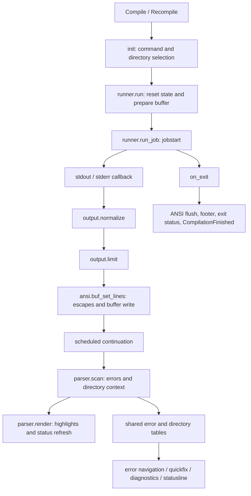

# Implementation and performance guide

This guide describes the current implementation. User-facing commands, options,
events, and mappings are documented in [compile-mode.txt](compile-mode.txt).
The runtime manages one shared compilation session. The internal modules below
provide boundaries for maintenance and measurement; the supported entry point
remains `require("compile-mode")`.

## Functional map

| Responsibility | Implementation | Behavior |
| --- | --- | --- |
| Command entry and completion | `plugin/command.lua`, `plugin/completion.vim`, `init.lua` | `Compile`, `Recompile`, default commands, input completion, command history and working-directory selection |
| Compilation lifecycle | `runner.lua` | Save/interrupt prompts, command expansion, buffer initialization, subprocess callbacks, environment/PTY options, exit messages and user events |
| Output normalization | `output.lua` | Reassemble unfinished lines, remove callback-encoded NULs, apply hidden-output patterns, handle carriage returns and enforce the output budget |
| Terminal sequences | `ansi.lua` | CSI/SGR filtering or Baleia rendering, OSC handlers, hyperlinks and incomplete escape sequences |
| Buffer operations | `buffer.lua` | Header/footer writes, optional trimming, buffer options, scrolling and window closing |
| Buffer interpretation | `parser.lua` | Scan output ranges, collect errors/directory changes/command-prefix highlights, then render highlights and refresh status |
| Error recognition | `errors/init.lua`, `errors/matchers.lua` | Built-in matcher data, configured matcher ordering, capture ranges, severity, filename exclusions, error highlighting and quickfix/diagnostic conversion |
| Directory context | `dir.lua` | Compilation working directory, per-line directory transitions and filename resolution |
| Session metadata | `state.lua`, `constants.lua` | Current error, automatic-jump/follow flags, reset and line-number adjustment; shared severity/exit codes and header size |
| Error navigation | `navigation.lua` | Next/previous/first/current errors, file-wise navigation, cursor following, `gf` and debug inspection |
| Editor helpers | `utils.lua` | Async waits/input, regex capture positions, windows, source-file jumps, locus highlights, diagnostics and save prompts |
| Status and integrations | `statusline.lua`, `extensions/`, `lua/telescope/_extensions/` | Error counts, running/exit status, lualine and Telescope integration |
| Configuration and support | `config/`, `health.lua`, `log.lua` | Defaults, option validation/types, health checks and logging |
| Compilation filetype | `ftplugin/compilation.lua`, `plugin/highlights.vim` | Buffer commands, keymaps, syntax highlights, cursor-follow events and parsing of existing log buffers |

Paths in the table are relative to `lua/compile-mode/` unless they begin with
`plugin/`, `ftplugin/`, or `lua/`.

## Execution flow

`runner.run` checks save/interrupt preferences, expands the command if requested,
opens or reuses the compilation buffer, writes the header, and starts the job.
`run_job` owns the job-local partial line, callback-data count, exit flag, and
line-limit flag. Stdout and stderr currently use the same callback and partial
line. `Compile!` waits through `jobwait`; normal compilation runs asynchronously.

Each nonempty output callback replaces the buffer's unfinished last line.
Normalization happens before ANSI handling. After writing, the callback yields
through `utils.wait()` before interpreting the updated range. `parser.scan`
updates metadata and may trigger the configured first-error jump;
`parser.render` applies error and command-prefix highlights and redraws status.
The compatibility hook `_parse_errors` invokes both stages.

After the job exits, `runner.run` checks that it still owns the current job,
flushes pending ANSI text, appends the completion footer, updates status, and
emits `CompilationFinished`. Explicit interruption emits
`CompilationInterrupted`. These events and their payloads remain unchanged.
The output callback and completion path have scheduled work: an exit event is
not a general barrier for all UI updates.

Existing buffers with the `compilation` filetype take a second path:
`ftplugin/compilation.lua` calls `_parse_errors` over the full buffer, initially
and after text changes. These buffers share the same error/directory tables as
the command-driven session.

## State and coordinate contracts

| State | Owner and lifetime |
| --- | --- |
| `vim.g.compile_command` | Last selected command; reused by `Recompile` and the prompt |
| `vim.g.compilation_directory` | One-shot user override consumed by `Compile` |
| `dir.compilation_directory` | Working directory retained for recompilation and source lookup |
| `vim.g.compile_job_id` | Current subprocess identifier, also consumed by interruption and statusline code |
| `vim.g.compilation_buffer` | Buffer identifier set by the compilation ftplugin |
| `vim.g.compilation_exit_code` | Last completion status; also cleared by the job's buffer-deletion handler |
| `errors.error_list` | Sparse table keyed by one-based compilation-buffer line number |
| `dir.dir_changes` | Directory transitions keyed by one-based compilation-buffer line number |
| `state.error_cursor` | Line key of the selected error; zero means no selection |
| `state.has_auto_jumped` | Reset for each run |
| `state.in_next_error_mode` | User toggle; persists across recompilation |
| Job callback locals | Fresh for each `run_job` invocation |
| ANSI partial text, mode and renderer | Module-local state in `ansi.lua`; `flush` handles completion and `reset` clears initialization/partial text |
| Error matcher caches | Module-local ordered matcher list/config plus compiled regexes on matcher tables |

`state.reset()` resets error metadata, directory transitions, the error cursor
and automatic-jump flag at the existing point in the run lifecycle. It does not
reset command history, process globals, ANSI state or configuration caches.
The legacy `errors.error_list` and `dir.dir_changes` locations are retained for
existing consumers; always access the current table rather than holding a
reference across a run/reset.

Coordinate rules are particularly important for future changes:

- The header occupies four lines; line four is the command. Output starts at
  line five. The command itself may contain an error or directory transition.
- Buffer API ranges are zero-based and end-exclusive. `-1` denotes the end.
  `parser.scan(bufnr, start, end_)` uses these conventions.
- `CompileModeError.linenum` is a one-based **output** line. `error.row.value`
  is a one-based **source-file** line. They are distinct coordinates.
- Error capture ranges use one-based, inclusive byte positions. Extmarks use
  zero-based byte positions and exclusive ends.
- A directory transition applies to later lines: lookup tests
  `transition_line < error_line`.
- Normalization returns both displayed lines and a raw unfinished tail. Hidden
  patterns and carriage returns must be reevaluated when the next chunk arrives.
- `max_lines` limits output, excluding the header. The callback budget accounts
  for replacement of the unfinished line. Overflow stops the job; the footer is
  written without trimming. This is not a rolling output window.
- `buffer.set_lines` returns the number of removed lines; metadata adjustment is
  a separate `state.trim_lines` operation. ANSI output uses its own writer.

## Measurement boundaries

Runnable issue probes, benchmarks, recorded results, and prioritized follow-ups
are in the [performance report](performance.md).

The refactor does not add timers to normal execution or claim a speedup.
Use the following functions to isolate costs before choosing an optimization.

| Area | Entry points | Useful workload dimensions |
| --- | --- | --- |
| Text preparation | `output.normalize`, `output.limit` | Bytes/chunk, chunk count, partial-line splits, hidden patterns, CR/NUL content, output limit |
| Error recognition | `errors.parse`, `utils.matchlistpos` | Matching/nonmatching lines, line length, matcher count/order, exclusions, cold/warm regex caches |
| Range scanning | `parser.scan` | Lines/range, accumulated errors, directory messages, command prefixes; disable auto-jump to exclude source navigation |
| Error rendering | `parser.render`, `errors.highlight`, `utils.add_highlight` | New and accumulated errors, extmark count, already-highlighted versus fresh errors |
| Escape processing and writes | `ansi.buf_set_lines`, `ansi.flush`, `buffer.set_lines` | Filter/render/passthrough, SGR/OSC density, chunk boundaries, Baleia version, visible/hidden windows |
| Directory lookup | `dir.find_directory_for_line`, `dir.resolve_filename` | Transition count, nesting, relative/absolute paths |
| Navigation and export | `navigation.*`, `errors.toqflist`, `errors.todiagnostic` | Error count, severity threshold, source-file count, window layout |
| Statusline | `statusline.info`, `statusline.format` | Error count and redraw/integration call frequency |
| End-to-end compilation | Public `compile` / `recompile` and user events | Producer speed, stdout/stderr mix, callback distribution, PTY, shell, scheduling and UI configuration |

For repeatable measurements, record Neovim/OS/dependency versions, configuration,
input bytes, line count, callback count and chunk sizes. Use fixed input corpora
containing ordinary text, errors, directory messages, ANSI sequences, and long
or fragmented lines. Keep fixture construction outside timed sections.

Measure synchronous stages with `vim.uv.hrtime()` and report repeated samples
(for example median and p95), bytes/second or lines/second as appropriate.
Use a fresh process for cold-cache runs; separately warm up LuaJIT and matcher
caches for steady-state runs. Clear/rebuild metadata and highlights consistently
between rendering samples, because already-highlighted errors are skipped.
Report memory separately: Lua allocation measurements do not include all buffer
and extmark memory held by Neovim.

Do not time only the call to an `a.void` command: it can return before the
asynchronous operation completes. End-to-end measurements should observe the
relevant user event and account for pending scheduled rendering separately.
Headless measurements are useful for parsing and API costs; validate visible
buffer responsiveness in a real editor as a separate workload.

## Follow-up investigation points

These are observations from the current code, not measured bottlenecks or
behavior changes made by this refactor:

- `errors.highlight` visits the complete error table after each parsed chunk,
  even though individual entries have an `highlighted` guard.
- Status counts traverse all errors; navigation collects and sorts error keys
  per action; directory lookup scans all recorded transitions.
- Regex matching may use both a compiled `match_str` call and `vim.fn.matchlist`
  to reconstruct capture positions. Command-prefix matching compiles its pattern
  on each call through `utils.matchlistpos`.
- Parsing updates matching entries but does not remove stale entries/highlights
  when a previously parsed line stops matching. Reparsed error lines receive
  fresh error objects. Include edited logs and partial-line replacement in
  correctness work before changing incremental parsing.
- ANSI state and the session metadata are shared, and stdout/stderr share an
  unfinished line. Stream isolation and lifecycle changes need dedicated tests.
- The error parser retains its first resolved config and matcher order. Reloading
  only `config.internal` does not invalidate those caches.
- Quickfix/diagnostic conversion currently passes a source row to directory
  resolution, which expects an output line. Test directory transitions with
  deliberately different source/output rows before changing that behavior.
- Job exit, pending callbacks, repeated buffer-deletion handlers and failed job
  startup are lifecycle cases to examine before introducing batching or queues.

## Validation map

Run `make test`, `make fmt-check`, and `make typecheck` with the development
dependencies described in [CONTRIBUTING.md](../CONTRIBUTING.md). A focused suite
can be run as `make test/output` or `make test/parser`.

| Behavior | Existing/focused suites in `spec/` |
| --- | --- |
| Commands and lifecycle | `basic`, `default_command`, `completion`, `bang_expansion`, `interrupt`, `multi_step_command` |
| Output and escapes | `output`, `carriage_return`, `nul_bytes`, `hidden_output`, `max_lines`, `ansi` |
| Parsing and navigation | `parser`, `error`, `threshold`, `auto_jump` |
| Directory and environment | `directory_change`, `compilation_directory`, `environment` |
| Scrolling | `auto_scroll` |

The focused `output` tests exercise deterministic callback boundaries without
depending on how a shell chunks its output. The `parser` tests exercise a log
buffer without a subprocess, checking output/source coordinates, directory
context, and the scan/render separation.
